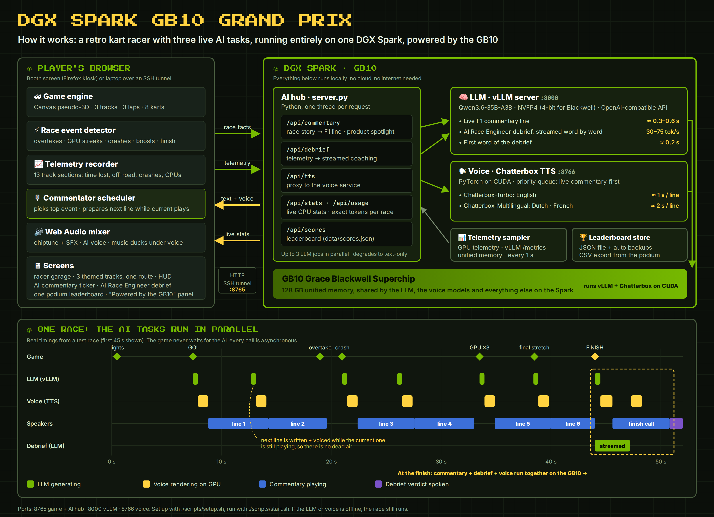

# DGX Spark GB10 Grand Prix

A retro, Mario-Kart-style kart racer for events, running entirely on one **DGX Spark**, powered by the GB10. One player at a time,
keyboard only. While you race, three AI tasks run in parallel on the Spark's GB10 GPU:

1. **Live F1-style AI commentator**: a local LLM calls every overtake, crash and GPU grab from this race's own story,
   and a GPU text-to-speech model speaks it in English, Dutch or French. Each race also includes one short **tech spotlight**
   on the technology behind the race (facts from `server/products.json`).
2. **AI Race Engineer debrief**: after the finish, the LLM analyses your telemetry per track section and streams a
   race-engineer verdict with 3 concrete tips. The finish call and the verdict give your **event leaderboard** position.
   The results screen shows the exact **AI tokens used in your race**: LLM input and output tokens, plus voice text and
   speech tokens, counted on the Spark.
3. **"Powered by DGX Spark" panel**: live GPU load, power, tokens/s and the number of AI tasks running right now.



## The game

- **Build your own kart.** A fresh install has no racers. Press **＋** (or ⚙ SETTINGS → Racer garage) to add one: pick a
  name, car colour, racer (suit/helmet) colour and one of 5 wheel styles. The name is painted on the bumper and the suit.
  Racers are saved on the Spark (`data/racers.json`) and can be edited or deleted in Settings.
- **Pick one of 3 tracks:**
  1. **AI Factory**: aisles of GB300 NVL72, Vera Rubin NVL72 and Rubin NVL8 racks, a cooling plant, cable trays
     and delivery robots.
  2. **HQ Campus**: through the Endeavor and Voyager office buildings (triangular skylights, Voyager's
     "Mountain") and the park under the solar trellis between them.
  3. **Coral Reef**: underwater, with corals, a kelp tunnel, a drop-off, a coral arch, and OpenClaw lobsters sitting on
     Lobster Rock and swimming above the track.
- **1, 2 or 3 laps** (⚙ Settings, 3 by default; the setting is stored on the Spark so every screen uses the same) against
  7 rivals: other garage racers plus AI rivals named after GPU architectures. Collect floating **GPUs**. Every 5 charge the turbo. Green pads give a boost.
- **Score = race time − 0.5 s per GPU** (−10 s extra for collecting all of them). Lowest score wins.
- **All three tracks share the same route** (curves, hills, length, boost pads) and the same GPUs in the same spots, so
  lap times are comparable. Only the scenery differs.
- **One leaderboard** for all tracks (one per lap setting, since a 1-lap time can't be compared with a 3-lap time), with each
  racer listed once with their best run and the track it was set on (every run is still stored). The podium shows the top 3, everyone else is listed below, and CSV export is available.

| Key | Action |
|---|---|
| ← → / A D | steer |
| ↑ / W | gas (hold just before GO for a rocket start) |
| ↓ / S | brake |
| Space | turbo |
| 1 / 2 / 3 | choose track (start screen) |
| P / Esc | pause (Q quits the run) |
| M | all sound on/off |
| V | AI voice on/off |

## Deploy on a fresh DGX Spark

**Needs:** DGX Spark with DGX OS (GPU driver, Docker and the GPU container toolkit come preinstalled), internet for
the first setup, and about 40 GB of free disk (22 GB LLM, 7 GB voice models, 6 GB Python environment, plus the vLLM container image).

```bash
git clone <this-repo> gb10-grand-prix
cd gb10-grand-prix
./scripts/setup.sh      # voice-service environment + voice models + vLLM container image (~15 min)
./scripts/llm.sh        # start the LLM; first run downloads the ~22 GB model
./scripts/start.sh      # start the game (add --kiosk for a fullscreen booth screen)
```

If an OpenAI-compatible LLM already runs on the Spark, `llm.sh` and `start.sh` reuse it. Use `./scripts/setup.sh --skip-llm` to skip the container image.

### Play from a laptop over SSH

The game only listens on `127.0.0.1` of the Spark. Forward the port from your laptop:

```bash
ssh -N -L 8765:127.0.0.1:8765 <user>@<spark-address>
```

Then open <http://localhost:8765/>. Sound plays on the laptop. Scores are saved on the Spark.

### Day-to-day

```bash
./scripts/status.sh       # what is up
./scripts/stop.sh         # stop game + voice  (--all also stops the race's vLLM container)
./scripts/start.sh        # start again (after a reboot too; the vLLM container restarts itself)
```

- Leaderboard: `data/scores.json`. "Reset board" in the game first saves a backup in `data/`.
- Logs: `data/server.log`, `data/tts.log`, `docker logs race-vllm`.

## Configuration

**Product spotlight:** edit `server/products.json` (name + facts). The commentator may only use the facts listed there,
and the products rotate so that consecutive races feature different ones. Restart the server after editing.

Copy `.env.example` to `.env` and uncomment what you need: ports, `LLM_URL` (any OpenAI-compatible server), the model,
the vLLM image and its memory share. Game tuning (laps, CPU speed, GPU bonus) is in the constants at the top of `web/js/game.js`.

**Difficulty:** `CPU_PACE` at the top of `web/js/game.js` sets the AI rivals' top speed.

## Components

| Path | What | Runs on |
|---|---|---|
| `web/` | The game, no build step. `js/game.js` engine, garage, leaderboards and AI client · `js/tracks.js` the 3 tracks · `js/art.js` karts and shared sprites · `js/util.js` helpers. | Player's browser |
| `server/server.py` | Static files, racers + leaderboard, AI hub (`/api/commentary`, `/api/debrief`, `/api/tts`, `/api/stats`, `/api/usage`). Python stdlib only. | Spark :8765 |
| `tts/tts_server.py` | Chatterbox TTS on CUDA (Turbo for EN, Multilingual for NL/FR), priority queue. | Spark :8766 |
| vLLM container | `nvidia/Qwen3.6-35B-A3B-NVFP4` behind an OpenAI-compatible API. | Spark :8000 |
| `scripts/` | setup / llm / start / stop / status | Spark |
| `tests/e2e_race.py` | Headless full race with live AI, against an isolated test leaderboard | Spark |

The game never waits for the AI. If the LLM or the voice is down, the race still works: commentary goes quiet and the
debrief falls back to basic tips.

## Testing

```bash
python3 -m venv .venv-test && .venv-test/bin/pip install -r tests/requirements.txt
.venv-test/bin/python -m playwright install chromium
.venv-test/bin/python tests/e2e_race.py --lang nl --track coral-reef
```

## Security notes

- All services bind to `127.0.0.1`. Nothing is exposed on the network. Remote play goes through an SSH tunnel.
- There's no authentication, so don't set `BIND_HOST=0.0.0.0` on an untrusted network.
- Player names stay on the Spark (`data/`, git-ignored). The LLM and voice run locally, so no data leaves the device.
- Secrets such as `HF_TOKEN` (only needed for gated models) belong in `.env`, which is git-ignored.

## Credits

Chatterbox TTS by Resemble AI (MIT). Qwen3.6 by the Qwen team (4-bit NVFP4 checkpoint, see the model ID). Served with vLLM. Computer rivals use GPU architecture names.
